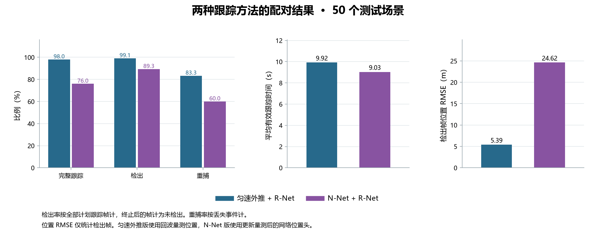
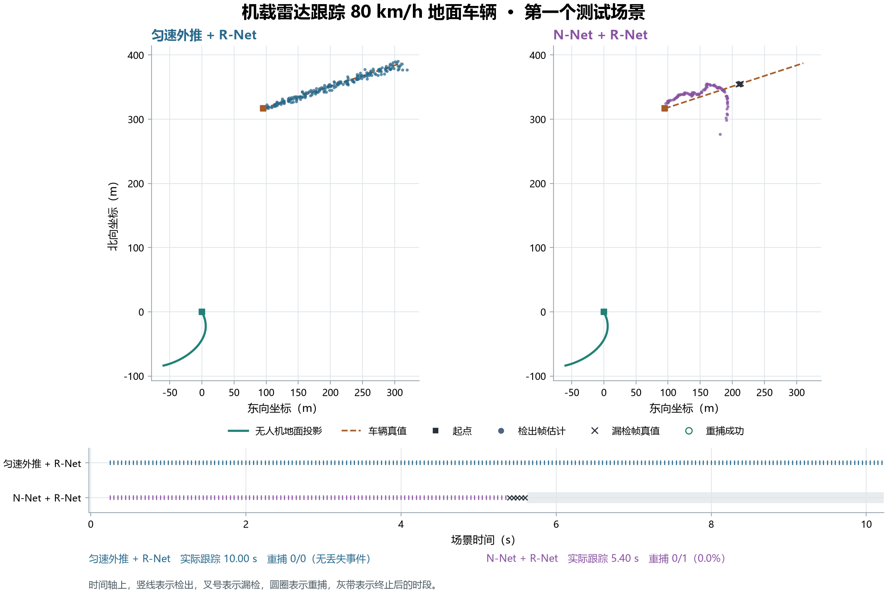

# 无人机跟踪 80 km/h 地面车辆

单架无人机在 60 m 高度按预定曲线飞行，同一辆车在地面沿直线匀速行驶。实验比较两种逐帧选束方法，使用相同的无人机航迹、车辆运动、量测噪声、每帧 4 束的预算和一对已训练的 N-Net、R-Net 权重。

## 两版如何跟踪

| 阶段 | 匀速外推 + R-Net | N-Net + R-Net |
| --- | --- | --- |
| 正常跟踪 | 用最近 5 帧内有效量测拟合三维匀速运动，外推下一帧并按阵列增益选 4 束 | 用 N-Net 对下一帧的 1024 个波束打分，取分数最高的 4 束 |
| 首次漏检后的下一帧 | R-Net 使用有效量测、已扫描的失败波束和原 N-Net 运动特征选束 | 相同 |
| 重捕或终止 | 重捕成功后恢复正常跟踪，连续漏检 5 帧则终止 | 相同 |
| 检出帧车辆位置 | 将本帧带噪量测转换到地面坐标 | 用本帧量测更新历史，将 N-Net 位置头输出转换到地面坐标 |

无人机的速度和转弯角速度平滑变化，航迹包含持续转弯和 S 形转弯。仿真每 5 ms 积分一次，每 50 ms 选束一次。开始时给定 5 帧有效观测，此后评估 200 帧，共 10 s。平台历史位置以及已下达的下一帧位移指令对两种方法均可用。算法将历史上的有效观测变换到同一阵列坐标系，再预测下一束。

## 配对测试结果

| 方法 | 完整跟踪 | 计划帧检出率 | 平均跟踪时间 | 重捕成功／丢失事件 | 检出帧位置 RMSE |
| --- | --- | --- | --- | --- | --- |
| 匀速外推 + R-Net | 49/50（98%） | 99.06% | 9.916 s | 5/6（83.33%） | 5.39 m |
| N-Net + R-Net | 38/50（76%） | 89.32% | 9.031 s | 21/35（60.00%） | 24.62 m |

完整跟踪表示 200 帧结束前未触发连续漏检上限。计划帧检出率的分母是 50 个场景的全部 10,000 个评估帧，包含提前终止后的帧。平均跟踪时间按实际尝试的帧数计，含触发终止的最后一帧。一次连续漏检计为一个丢失事件。两版遭遇的丢失事件集合不同，重捕率反映各自闭环中的表现。位置 RMSE 的估计器和检出帧集合都随方法变化。

两版均沿用前期复现训练的权重。模型历史窗口 5 帧，训练预测长度 5 帧，闭环每次取下一帧。隐藏维度 256，8 个注意力头，N-Net 的 MAFE 编码器为 4 层，R-Net 的 FF 解码器为 2 层。50 个独立验证场景上，两版分别完成 49 和 40 个场景，满足本实验保留原权重的规则，因此没有启动微调。验证和测试结果分别见 [validation_summary.csv](results/validation_summary.csv) 和 [test_summary.csv](results/test_summary.csv)。





## 运行

从本版本目录执行下列命令。验证环境为 Python 3.12.15、NumPy 2.5.4、PyTorch 2.12.1+cu126、Matplotlib 3.11.2，支持 CPU 或 CUDA。依赖可在已有兼容环境中通过 `python -m pip install numpy torch matplotlib` 安装。

无需权重即可运行两组回归测试，验证航迹生成、坐标转换、漏检掩码、波束选择和重捕路由。

```shell
python -m unittest discover -s source/my_training/checks -p "test_uav_vehicle_*.py"
```

完整实验需要使用者提供相互匹配的 N-Net 和 R-Net 模型。编辑 [current_journal_experiment.json](source/my_training/outputs/current_journal_experiment.json)，将两个字段分别指向自己的模型文件。示例名称可自行更换，路径从 `source/my_training/` 下的 `outputs/` 开始。

```json
{
  "nnet_checkpoint": "outputs/user_models/normal.pth",
  "rnet_checkpoint": "outputs/user_models/recovery.pth"
}
```

```shell
python source/my_training/isac/run_uav_vehicle.py --device auto
```

入口按固定种子生成验证场景，在锁定权重选择后生成测试场景。新结果写入 `source/my_training/outputs/uav_vehicle_cv_nr/run_*/`。验证触发微调时，还会单独生成 N-Net 训练和 R-Net 重捕训练场景。运行参数可通过 `--help` 查看。

## 结果适用范围

车辆匀速直行，与匀速外推模型的运动假设一致。初始水平距离 280–510 m，初始方向在正北两侧各 18° 以内，道路方向偏离东西向至多 25°。机载阵列常姿态，导航位置和位移指令准确执行。量测采用距离、方位角和极角的加性高斯噪声，标准差分别为 1 m、0.5° 和 0.5°。检出条件为选中的波束集合包含真实方向对应的 DFT 波束。本结果评估该几何量测模型下的闭环表现，真实机载回波、散射、多径、遮挡、平台姿态和导航误差仍需单独验证。

实验参数、权重选择记录与最终指标见 [config.json](results/config.json)、[selection.json](results/selection.json) 和 [summary.json](results/summary.json)。[manifest.json](manifest.json) 提供各公开文件的 SHA-256。源程序位于 [source/my_training](source/my_training)。
